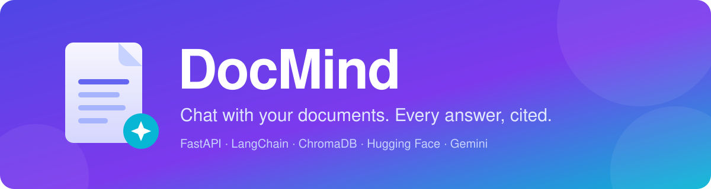
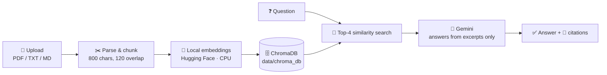

<div align="center">



<br/>

### Stop skimming 200 pages. Just ask.

**DocMind** is a local-first research assistant. Upload your PDFs, notes, and Markdown files, ask questions in plain language, and get answers that come **only from your documents**, with the exact file, page, and passage cited.

<br/>


-06B6D4?style=flat-square)

[Features](#-features) · [How it works](#-how-it-works) · [Quick start](#-quick-start) · [API](#-api-reference) · [Roadmap](#-roadmap) · [Privacy](#-privacy)

</div>

---

## Why DocMind?

Finding and verifying an answer across several long documents is slow, and language models happily invent answers when they don't know. DocMind is built around one rule:

> **If it isn't in your documents, DocMind says so.**

Every answer is grounded in retrieved passages, shown with citations so you can verify it in seconds. It runs on your own machine, and your documents survive a server restart.

## ✨ Features

| | Feature | Status |
|---|---|---|
| 📄 | Upload **PDF, TXT, MD** with extension allowlist and 10 MB limit | ✅ Done |
| ✂️ | Parse, chunk (800 / 120 overlap), and embed **locally** with Hugging Face | ✅ Done |
| 🗄️ | Persistent vector store (Chroma): documents survive restarts | ✅ Done |
| 💬 | Ask questions across **all** uploaded documents | ✅ Done |
| 🛡️ | **Grounded answers**: answers only from retrieved context, otherwise *"I couldn't find that in your documents."* | ✅ Done |
| 🔖 | **Citations** with filename, page, chunk index, and text preview | ✅ Done |
| 🌍 | Replies in the language of the question (multilingual embeddings) | ✅ Done |
| ⚠️ | Friendly handling of Gemini rate limits, bad keys, and outages | ✅ Done |
| 📚 | Document library: list and delete documents (and their chunks) | 🛠️ Planned (Tier 2) |
| 🧠 | Conversation memory with follow-up question rewriting | 🛠️ Planned (Tier 2) |
| 🎯 | Scope selector: all documents or just one | 🛠️ Planned (Tier 2) |
| 📝 | Per-document summaries | 🛠️ Planned (Tier 2) |
| 🚦 | Relevance guard: skip the LLM call when nothing relevant is retrieved | 🛠️ Planned (Tier 2) |
| 🖥️ | React + TypeScript frontend with loading states and clear-chat | 🛠️ Planned (Tier 2) |
| ⚙️ | Settings panel, Markdown export, duplicate detection, `/health`, request logging | 🔭 Stretch (Tier 3) |

## 🧩 How it works



### What runs where

| Step | Where it runs | Network? |
|---|---|---|
| Parsing, chunking, embedding | Your machine (CPU) | No |
| Vector storage and search | Your machine (Chroma on disk) | No |
| Answer generation | Google Gemini API | **Yes**: the question and retrieved excerpts are sent |

Indexing a large PDF is safe and unlimited because it's all local. Asking many questions in quick succession can hit Gemini's free-tier rate limits, and DocMind reports that clearly instead of crashing.

## 🛠 Tech Stack

| Layer | Technology |
|---|---|
| API | FastAPI, Uvicorn, Pydantic v2 |
| Orchestration | LangChain (`core`, `chroma`, `huggingface`, `google-genai`, `text-splitters`) |
| Embeddings | `sentence-transformers/paraphrase-multilingual-MiniLM-L12-v2` (local) |
| Vector store | ChromaDB, persistent, cosine similarity |
| LLM | Google Gemini (`gemini-3.5-flash-lite`) via Google AI Studio |
| Parsing | `pypdf`, plain-text reading |
| Frontend *(planned)* | React + Vite + TypeScript |

## 🚀 Quick Start

### Prerequisites

- Python 3.10+
- A free [Gemini API key](https://aistudio.google.com/apikey) from Google AI Studio
- Disk space for PyTorch and the embedding model (downloaded once on first run to `~/.cache/huggingface/hub`)

### Install

```bash
git clone https://github.com/EdrisKorbi/docmind.git
cd docmind

python -m venv venv
source venv/bin/activate          # Windows: venv\Scripts\activate

pip install -r requirements.txt
```

### Configure

Create a `.env` file in the project root (it is git-ignored, so never commit it):

```env
GEMINI_API_KEY=your_api_key_here

# Optional: comma-separated CORS origins (default: local Vite dev URLs)
ALLOWED_ORIGINS=http://localhost:5173
```

| Variable | Required | Description |
|---|---|---|
| `GEMINI_API_KEY` | For `/api/ask` | Gemini key. Uploading and indexing work without it. |
| `ALLOWED_ORIGINS` | No | Browser origins allowed by CORS. |

### Run

```bash
uvicorn main:app --reload --port 8000
```

> `--reload` is for development only.

- API: `http://localhost:8000/api`
- Swagger UI: `http://localhost:8000/docs`

### Verify your setup

```bash
python -m scripts.test_embeddings   # local model loads and embeds (offline)
python -m scripts.test_gemini       # Gemini key and model reachable (1 API call)
python -m scripts.test_rag_cli      # full ingest → retrieve → answer demo
```

## 📡 API Reference

Every response uses one envelope:

```json
{ "success": true, "data": {}, "message": "Human-readable status" }
```

### `GET /api/ping`

Health check.

```json
{ "success": true, "data": { "status": "ok" }, "message": "DocMind API is running." }
```

### `POST /api/documents/upload`

Upload and index a document (`multipart/form-data`, field `file`).

```bash
curl -X POST http://localhost:8000/api/documents/upload -F "file=@handbook.pdf"
```

```json
{
  "success": true,
  "data": {
    "doc_id": "3f6c1e0e-...",
    "filename": "handbook.pdf",
    "chunk_count": 42,
    "uploaded_at": "2026-11-25T13:00:00+00:00"
  },
  "message": "Uploaded and indexed 'handbook.pdf' (42 chunks)."
}
```

| Status | Meaning |
|---|---|
| `201` | Uploaded and indexed |
| `400` | Unsupported type, empty file, invalid filename, or no readable text |
| `409` | A document with the same name already exists |
| `413` | File exceeds the 10 MB limit |

### `POST /api/ask`

```bash
curl -X POST http://localhost:8000/api/ask \
  -H "Content-Type: application/json" \
  -d '{"question": "How long is the warranty?"}'
```

```json
{
  "success": true,
  "data": {
    "answer": "Every unit includes a 42-month standard hardware warranty.",
    "citations": [
      {
        "doc_id": "3f6c1e0e-...",
        "filename": "handbook.txt",
        "page": 0,
        "chunk_index": 1,
        "preview": "2. Warranty and Support SLA Every Atlas Rover X2 unit includes..."
      }
    ]
  },
  "message": "Answer generated successfully."
}
```

`question` must be 1–2000 characters. For text files `page` is `0`. When nothing relevant is found, the answer is `"I couldn't find that in your documents."` with empty `citations`.

| Status | Meaning |
|---|---|
| `200` | Answer generated |
| `422` | Invalid request body |
| `429` | Gemini rate limit or quota reached |
| `503` | Missing or invalid API key, or model unavailable |
| `500` | Unexpected error (details logged server-side, never leaked) |

## 🗂 Project Structure

```
docmind/
├── main.py                      # FastAPI app, CORS, global error handlers
├── requirements.txt
├── assets/banner.svg            # README banner
├── app/
│   ├── config.py                # Paths, model names, limits, env loading
│   ├── errors.py                # Domain exceptions + Gemini error mapping
│   ├── routes/api.py            # Thin /api routes
│   ├── schemas/api_schemas.py   # Pydantic request/response models
│   ├── services/
│   │   ├── document_service.py  # Upload, parse, chunk, register
│   │   └── rag_service.py       # Retrieval, grounded prompt, citations
│   └── storage/vector_store.py  # Cached embeddings + Chroma client
├── scripts/                     # Manual smoke tests (no test suite by design)
└── data/                        # Runtime only, git-ignored
    ├── uploads/                 # Stored original files
    ├── chroma_db/               # Vector database
    └── documents.json           # Document registry
```

## ⚙️ Tuning

| Setting | Default | Where |
|---|---|---|
| Chunk size / overlap | 800 / 120 characters | `document_service.py` |
| Retrieved chunks (top-k) | 4 | `rag_service.py` |
| LLM temperature | 0.0 | `rag_service.py` |
| Max upload size | 10 MB | `config.py` |
| Gemini model | `gemini-3.5-flash-lite` | `config.py` |
| Embedding model | `paraphrase-multilingual-MiniLM-L12-v2` | `config.py` |

> Changing the embedding model means deleting `data/` and re-uploading, because existing vectors won't match the new model.

## 🔐 Security

- `GEMINI_API_KEY` lives only in `.env` and is never hardcoded or logged.
- Uploads use an extension allowlist, sanitized filenames, a hard size limit, and server-generated names on disk. Client paths and content types are never trusted.
- Failed ingests clean up their partial files.
- Errors reach the client as friendly messages; stack traces stay in the server log.

## 🔒 Privacy

Documents, embeddings, and the vector index stay on your machine. When you ask a question, the question and the top retrieved excerpts are sent to the Gemini API.

> ⚠️ **On the Gemini free tier, Google may use prompts and the document excerpts sent with them to improve its products.** Don't upload sensitive or private documents while using the free tier, and check [Google's current Gemini API terms](https://ai.google.dev/gemini-api/terms) for details.

## 🗺 Roadmap

- [x] **Tier 1: Core.** Upload, local embeddings, persistent store, grounded answers with citations
- [ ] **Tier 2: Intermediate.** Document library and delete, conversation memory, scope selector, summaries, relevance guard, React frontend
- [ ] **Tier 3: Stretch.** Settings panel, Markdown export, duplicate detection, `/health`, request logging

Out of scope by design: auth, user accounts, SQL databases, Docker, deployment, streaming, agents, OCR for scanned PDFs, and automated test suites.

## 🤝 Contributing

Issues and pull requests are welcome. For larger changes, please open an issue first to discuss what you'd like to change.

## 📄 License

No license file is included yet. Add one (for example MIT) to clarify usage terms.

---

<div align="center">

Built by [Edris Korbi](https://github.com/EdrisKorbi) · FastAPI · LangChain · ChromaDB · Gemini

</div>
